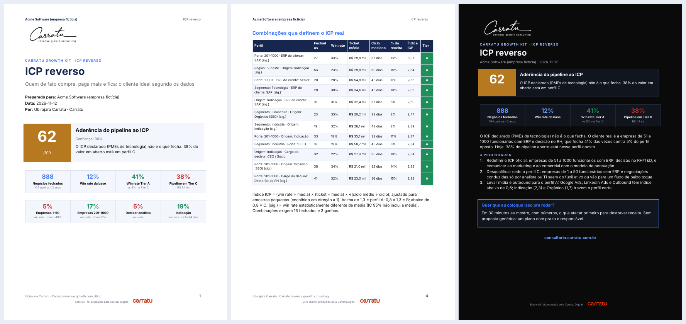

# ICP reverso · Reverse ICP

**Carratu Growth Kit** · Skill para o Claude · por [Ubirajara Carratu](https://www.linkedin.com/in/carratu) ·
[Carratu revenue growth consulting](https://consultoria.carratu.com.br) · v1.0.0 (nov/2026)



## PT-BR

Todo time tem um ICP no slide. Poucos têm o ICP que os dados confirmam. Esta skill lê os negócios **ganhos e perdidos**
do seu CRM (e a retenção, se houver) e mostra quem de fato compra, paga mais, fecha mais rápido e fica, com estatística
honesta para não confundir sorte com padrão.

### O que ela entrega

- **Índice ICP** por segmento, porte, região, origem e qualquer atributo extra (ERP ou stack, cargo do decisor, nº de
  unidades), juntando win rate, ticket e ciclo, com **encolhimento para amostras pequenas** e marcação de significância.
- **Combinações que definem o ICP real** (ex.: porte 201-1000 + ERP SAP) com exigência de amostra mínima.
- **Tiers A/B/C** e **modelo de pontuação** em CSV, pronto para virar propriedade de pontuação no CRM.
- **Pipeline aberto classificado**: quanto do valor em aberto está em perfil C (esforço com baixa chance).
- **Retenção por perfil**: quem fecha fácil e cancela rápido não é ICP.
- **Ficha do ICP real vs declarado**, recomendações com dono e plano 30/60/90, em DOCX e PDF com a marca Carratu.

### Como usar

> "Qual é o meu ICP real? Segue o export do HubSpot com ERP e cargo do decisor"
> "Valide se PMEs de tecnologia são mesmo nosso melhor cliente"
> "Crie um lead scoring baseado nos negócios que ganhamos"

Instalação: baixe o ZIP (Code → Download ZIP) e envie em **Configurações → Capacidades → Skills** no Claude, com
execução de código ativada. Exemplo completo (dados fictícios) em [`examples/`](examples/).

## EN

Finds your real ideal customer profile from won and lost deals (plus retention data if available): an ICP index per
attribute and combination with small-sample shrinkage and significance flags, A/B/C tiers, a CRM-ready scoring model,
your open pipeline scored by tier and a DOCX/PDF report. Ask in English for an English report.

## Estrutura · Structure

```
carratu-icp-reverso/
├── SKILL.md
├── references/  method.md · data-export.md · report-schema.md
├── scripts/
│   ├── normalize.py      lê o export de qualquer CRM (com --keep para atributos extras)
│   ├── icp.py            índice, combinações, tiers, modelo de pontuação, pipeline e retenção
│   ├── make_sample.py    dados fictícios para teste
│   └── carratu_*.py      dados, gráficos e relatório (comuns ao kit)
├── assets/               marca, logos e fontes (OFL)
└── examples/             dados fictícios, modelo de pontuação e relatório de exemplo
```

## Carratu Growth Kit

| Skill | Para quê · What for |
|---|---|
| [carratu-diagnostico-funil](https://github.com/biracarratu/carratu-diagnostico-funil) | Onde o funil vaza e quanto do pipeline é real |
| [carratu-ai-share-of-voice](https://github.com/biracarratu/carratu-ai-share-of-voice) | Quanto a sua marca aparece nas respostas das IAs |
| [carratu-icp-reverso](https://github.com/biracarratu/carratu-icp-reverso) | O ICP real, a partir de quem de fato compra |
| [carratu-abm-plays](https://github.com/biracarratu/carratu-abm-plays) | Contas em tiers, sinais de compra e plays de ABM |
| [carratu-briefing](https://github.com/biracarratu/carratu-briefing) | Briefing com escuta ativa antes de produzir |
| [carratu-relatorio-board](https://github.com/biracarratu/carratu-relatorio-board) | Marketing e vendas na língua do CFO |
| [carratu-diagnostico-seo-geo-aeo](https://github.com/biracarratu/carratu-diagnostico-seo-geo-aeo) | Visibilidade no Google e nas IAs |

## Licença · License

PolyForm Noncommercial 1.0.0: uso livre para fins não comerciais, inclusive dentro da sua empresa; uso comercial (vender
serviços feitos com a skill, embutir num produto pago) exige licença em
[consultoria.carratu.com.br](https://consultoria.carratu.com.br). Marcas e logos Carratu não estão incluídas. Detalhes
em `NOTICE.md`. Free for noncommercial use; commercial use requires a license.
